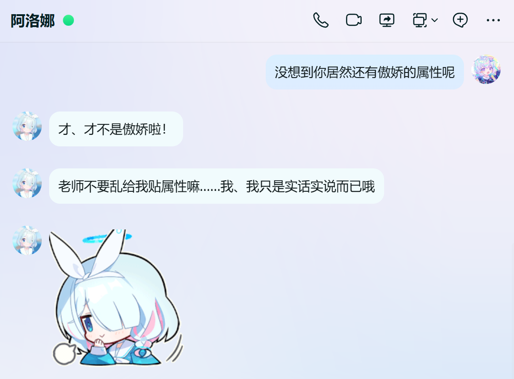

# AronaArchive

<p align="center">
  
</p>

<p align="center">
  <strong>A self-running digital character AI based on Arona from <em>Blue Archive</em></strong>
</p>

<p align="center">
  Through the system-maintained independent loop, the system is built as a presence that exists on its own, rather than one that only answers turn by turn. The user enters her logical world as an event.
</p>

<p align="center">
  <sub>The difference between this logical world and the real one is that the real world does not stop for any one person — but this one does.</sub>
</p>

<p align="center">
  <em>Version: 2.0.0</em>
</p>

<p align="center">
  <a href="README.md">中文</a> · <strong>English</strong>
</p>

---

## 📖 Introduction

**AronaArchive** is a non-conversational desktop AI modeled after Arona from the game *Blue Archive*. In lore she is the OS administrator of the Shittim Chest: cheerful, enthusiastic, and always ready to help Sensei (the user).

The project wires a life loop, inner thoughts and notes, relationship climate, a dual-model pipeline, proactive impulses, memory and world-lore, voice interaction, screen operation, Spine 2D character animation, and a QQ private-chat channel into one desktop pipeline, so Arona stays on the screen instead of inside a chat box.

<p align="center">
  
</p>

<p align="center">
  <em>Running example — Arona client & settings UI</em>
</p>

<p align="center">
  
</p>

<p align="center">
  <em>Running example — QQ</em>
</p>

---

## 🏗️ Project Architecture

```
AronaArchive/
├── backend/                              # Python backend (FastAPI + WebSocket)
├── frontend/                             # Desktop client (Qt/C++ + Spine)
├── tts/                                  # TTS backend (official / minimal)
├── llm/aronaLM/finetune/                 # AronaLM fine-tune (not actually a large model… I wrote that wrong earlier and still haven't changed it)
├── models/                               # Local model weights (download yourself)
├── docs/                                 # Architecture, hot-word lists, and other docs
├── assets/                               # Project assets
├── start-all.bat                         # Windows one-click local start for all services
├── pack-client.ps1                       # pack the desktop client
├── pack-backend.ps1                      # pack the Windows portable backend
└── pack-tts.ps1                          # pack TTS scripts and reference audio
```

See [`docs/architecture.md`](docs/architecture.md) for the full directory tree.

---

## ✨ Core Features

### 🤖 AI Engine

- **Life loop and inner thoughts**: Arona keeps a self-running realtime state; the user's actions enter her current thoughts and behavior; the wall clock and facts decide whether she thinks and what she thinks about; she decides whether to speak the thought result, or to keep thinking recursively as metacognition
- **Relationship climate**: three scalars — trust / dependence / tension — form a vector. User actions are classified by rules, then a lookup table updates the climate; climate zones decide whether she speaks, how she holds herself, or stays silent
- **Dual-model pipeline**: Planner intent planning → Renderer (AronaLM-Renderer-V2.x)
- **Screen vision and computer use**: when she needs information she reads the screen, and she completes tasks by operating the computer
- **Continuous dictation**: ASR fragments go into a buffer first and are submitted after silence; the system decides when to reply
- **Memory and knowledge are separate**: long-term user facts go to SQLite + FTS5 + Chroma; Arona's short-term memory goes to a JSON sliding window; world-lore goes Markdown corpus → local BGE + Chroma RAG; they are never mixed, and each is injected into the prompt on demand. The main dialogue path is not blocked; memories are extracted as LLM JSON

### 🖥️ Desktop Client, Voice, and QQ Private Chat

- **Spine 2D animation**: Arona's character art, expressions, and touch interaction
- **Qt UI**: Windows desktop app talking to the backend over WebSocket; the system tray can show/hide the window and toggle click-through and screenshot input
- **Text and voice**: a global hotkey opens a multi-line input box; Enter sends. Tencent Cloud real-time ASR turns speech into text; GPT-SoVITS synthesizes speech
- **Global hotkeys** (all of these can be changed in `config.json`):

| Default hotkey | Action |
|----------------|--------|
| `Ctrl+Alt+V` | Toggle voice input |
| `Ctrl+Alt+C` | Toggle click-through |
| `Ctrl+Alt+T` | Open text input |
| `Ctrl+Alt+X` | Toggle screen-capture input |
| `Ctrl+Alt+S` | Cancel the current computer-use run |

- **Napcat QQ access**: Arona connects to QQ through Napcat as another channel for sending messages, in parallel with the desktop pipeline and from the same source

---

## 🚀 Quick Start

### Backend

Download the packaged portable backend from the [Releases](https://github.com/xiahy456/AronaArchive/releases) page. The bundle includes a Python runtime; you do **not** need conda or Python installed on the machine.

1. Open the Releases page and download the latest **portable zip** (`AronaArchive_Backend_v*_x64.zip`)

2. After extracting, edit `config.yaml` in the directory and fill in at least these keys:

   - `planner.api_key` / `memory.extractor.api_key`: replace `YOUR_DEEPSEEK_API_KEY` with your DeepSeek API Key. **Planner requires a key**; without a key, or with `planner.enabled` off, the backend falls back to the local single model. Memory extraction without a key uses the regex fallback. When a screenshot or computer use is involved, Planner uses `planner.vision_model` (default `deepseek-flash`)
   - `model.enabled`: whether to enable Arona-Renderer rendering correction; `true` enables it, `false` uses the Planner draft only. Place the GGUF only when this is enabled. **Disabled by default**
   - `knowledge.enabled`: whether to enable world-lore RAG. The official zip already has the corpus ingested and keeps this **enabled by default**; the sample config for running from source is `false`, and you need to ingest the corpus first
   - `computer_use.enabled`: whether to allow Arona to operate the user's computer. **Enabled by default**; the client and backend need to be turned on together
   - `napcat.user_qq_id`: fill in the user's QQ number to use QQ private chat; leave it empty to only hold the reverse WebSocket, with nothing received or sent

3. Place models under `models/` in the extracted directory as needed (paths are already set in the bundled `config.yaml`; see the bundled `models/README.txt` or [`models/README.md`](models/README.md)):

   - When Renderer is enabled: `models/AronaLM-Renderer-V2.4/AronaLM-Renderer-V2.4.Q4_K_M.gguf`

4. Double-click `AronaArchive_Backend.bat` to start. Set the desktop client's `websocket_url` to `ws://127.0.0.1:20456/ws` (this is already the default).

> **System requirements**: Windows 10 / 11 x64. If it fails to start, run the bundled `vc_redist.x64.exe` first. Renderer GPU layers need an NVIDIA GPU and a reasonably recent driver. Do not extract a new version over a directory you are already using (unless you do not need to keep memory); runtime data lives in `data/memory/` and `logs/`.

Full field docs and running from source (conda env `shittim-chest` / `python -m app.main`) are in [`backend/README.md`](backend/README.md).

### Client

Download the packaged client from the [Releases](https://github.com/xiahy456/AronaArchive/releases) page.

1. Open the Releases page and download the latest **installer** (`AronaArchive_WindowsClient_v*_x64_Setup.exe`) or **portable zip** (`AronaArchive_WindowsClient_v*_x64.zip`)
2. After installing or extracting, edit `Config/config.json` in the program directory and fill in at least these keys:

```json
{
  "aronalm": {
    "websocket_url": "ws://127.0.0.1:20456/ws"
  },
  "tts": {
    "host": "127.0.0.1"
  },
  "tencent_speech_recognizer": {
    "secret_id": "${TENCENT_SECRET_ID}",
    "secret_key": "${TENCENT_SECRET_KEY}",
    "app_id": "${TENCENT_APP_ID}"
  }
}
```

Keep `tts.host` at `127.0.0.1` when TTS stays on this machine. When the backend is on a public server, use HTTPS and an access token as described in [Public Backend Deployment](#public-backend-deployment). Full field docs and building from source are in [`frontend/AronaArchive_WindowsClient/README.md`](frontend/AronaArchive_WindowsClient/README.md).

> **Note**: Upload [`docs/hot_word.txt`](docs/hot_word.txt) as a hot-word list in Tencent Cloud ASR and set it as the default hot-word list.

3. Start the client by running the client executable.

### QQ Private Chat

The backend has a built-in Napcat reverse-WebSocket endpoint. It shares `server.port` with the desktop client; the path defaults to `/arona`.

1. Deploy [Napcat](https://github.com/NapNeko/NapCatQQ) and log in to Arona's QQ account
2. In Napcat's reverse WebSocket settings, fill in:

   - URL: `ws://your-backend-host:20456/arona` (use `wss://your.domain/arona` on the public internet)
   - Token: the same as the backend's `napcat.napcat_token` (sent as `Authorization: Bearer`; leave empty if no token is set)

3. In the `napcat` section of the backend `config.yaml`, set `user_qq_id` to the user's QQ number. If it is empty, the connection stays up and private messages are neither received nor sent

> The Napcat token is set separately from `server.token`; an empty token is allowed under the same rule for both. See the `napcat` section in [`backend/README.md`](backend/README.md).

### Public Backend Deployment

The backend still listens only on `127.0.0.1:20456`. Open only port `443` on the firewall. Leave the client and TTS on the user's computer.

1. On the server, set `server.public: true` in `config.yaml` and fill in `server.token`. Generate the token with the command below. Do not use a short passphrase, and do not put the token in the WebSocket URL:

```bash
python -c "import secrets; print(secrets.token_urlsafe(32))"
```

If `server.token` is empty or still `YOUR_ACCESS_TOKEN`, the process refuses to start when `public: true` or when `host` is not local. On local `127.0.0.1` with `public: false`, a token can be left unset.

2. Reverse-proxy `wss://your.domain/ws` to `127.0.0.1:20456` with Caddy, Nginx, Apache, or similar, and forward the `Authorization` header unchanged:

```caddy
# Caddy example
your.domain {
    reverse_proxy 127.0.0.1:20456
}
```

3. Client `Config/config.json`:

```json
{
  "aronalm": {
    "websocket_url": "wss://your.domain/ws",
    "access_token": "same as the server's server.token"
  },
  "tts": {
    "host": "127.0.0.1"
  }
}
```

Without a domain, set `server.ssl_certfile` and `server.ssl_keyfile` in `config.yaml` and start with `python -m app.main`, so the process serves `wss` directly. On the client, put the path of the CA that issued that certificate in `aronalm.tls_ca_file`. When you have a domain, prefer the Caddy setup above.

### TTS Service

The official engine is used by default. See [`tts/README.md`](tts/README.md) for the full guide. To use the faster backend, set the client's `tts.backend` to `minimal`; steps are in [`tts/gpt-sovits-minimal/DEPLOY.md`](tts/gpt-sovits-minimal/DEPLOY.md).

1. Extract the [GPT-SoVITS Windows package](https://huggingface.co/lj1995/GPT-SoVITS-windows-package) (a [Yuque mirror](https://www.yuque.com/baicaigongchang1145haoyuangong/ib3g1e/dkxgpiy9zb96hob4#KTvnO) is available in China) into `tts/gpt-sovits/`. You should see `api_v2.py` and `runtime\python.exe`. If prompted to overwrite, skip `go-apiv2` / `ref_audio`.
2. Place the two voice files:

```
tts/gpt-sovits/
├── GPT_weights_v2/            # GPT weights
│   └── ALuoNa_cn-e15.ckpt
└── SoVITS_weights_v2/         # SoVITS weights
    └── ALuoNa_cn_e16_s256.pth
```

3. Extract `AronaArchive_GPTSoVITS_v*_x64.zip` from Releases to the repo root.
4. From the repo root, run `.\start-all.ps1`.

---

## 📚 Modules & Configuration

| Module | Docs |
|------|------|
| **Backend** | [`backend/README.md`](backend/README.md) |
| **Desktop client** | [`frontend/AronaArchive_WindowsClient/README.md`](frontend/AronaArchive_WindowsClient/README.md) |
| **TTS** | [`tts/README.md`](tts/README.md) · [`tts/gpt-sovits/DEPLOY.md`](tts/gpt-sovits/DEPLOY.md) · [`tts/gpt-sovits-minimal/DEPLOY.md`](tts/gpt-sovits-minimal/DEPLOY.md) |
| **Models** | [`models/README.md`](models/README.md) |
| **AronaLM fine-tune** (if you are a developer, see this doc) | [`llm/aronaLM/finetune/README.md`](llm/aronaLM/finetune/README.md) |

---

## 🙏 Acknowledgements

- **Blue Archive (ブルーアーカイブ)** — where all miracles begin (https://bluearchive-cn.com/)
- **Spine** — 2D animation engine (https://esotericsoftware.com/)
- **Kivo Wiki** — in-game assets and the Blueaka font (https://kivo.wiki/)
- **ChromaDB** — vector database (https://www.trychroma.com/products/chromadb)
- **DeepSeek** — Planner intent planning, vision screen-reading, computer-use multimodal control, and memory extraction API (https://www.deepseek.com/)
- **Qt** — cross-platform GUI framework (https://www.qt.io/)
- **GPT-SoVITS** — speech synthesis (https://github.com/RVC-Boss/GPT-SoVITS)
- **GPT-SoVITS_minimal_inference** — accelerated inference backend (https://github.com/GPT-SoVITS-Devel/GPT-SoVITS_minimal_inference)
- **Tencent Cloud ASR** — online speech recognition (https://cloud.tencent.com/product/asr)
- **bge-small-zh-v1.5** — text embedding model (https://huggingface.co/BAAI/bge-small-zh-v1.5)
- **Napcat** — QQ protocol framework, providing reverse WebSocket access (https://github.com/NapNeko/NapCatQQ)
- **llama.cpp / llama-cpp-python** — local GGUF inference (https://github.com/ggml-org/llama.cpp)
- **Qwen3-1.7B** — fine-tune base model (https://huggingface.co/Qwen/Qwen3-1.7B)
- **Unsloth** — efficient QLoRA fine-tuning (https://unsloth.ai/)

<p align="center">
  <strong>Thanks to everyone who helped with development, and to all the creators in the Blue Archive community</strong>
</p>
<p align="center">
  <strong>Thank you for the amazing works and energy you bring to this community</strong>
</p>

---

## ⚖️ License, Copyright, and Intellectual Property

This project is open source under the [GNU General Public License v3.0 or later (GPL-3.0-or-later)](LICENSE).

This project is an **unofficial fan work** modeled on Arona from *Blue Archive*, and has **no affiliation, partnership, or authorization** with NEXON, NEXON Games, Yostar, or other related rights holders. Characters, settings, trademarks, and other intellectual property in the game remain with the original rights holders. References in this project do not imply that a license has been granted, and this project claims no related rights.

[GPL-3.0-or-later](LICENSE) **applies only to this project's original source code and documentation**. This project is **not for profit**. If a rights holder wants related material removed, contact us using the details in **[About the Developer](#-about-the-developer)** below, and we will cooperate as soon as we can.

The repository includes third-party code whose licenses differ from GPLv3 and to which **GPLv3 does not apply**. See [`NOTICE.md`](NOTICE.md).

---

## ⭐ About the Developer

- **Project lead**: xia_hy456
- **Personal blog**: https://xia-hy456.top/
- **Feedback**: 2066961858@qq.com

---

<p align="center">
  <sub>/* Like strawberry milk, a sweet miracle */</sub>
</p>
